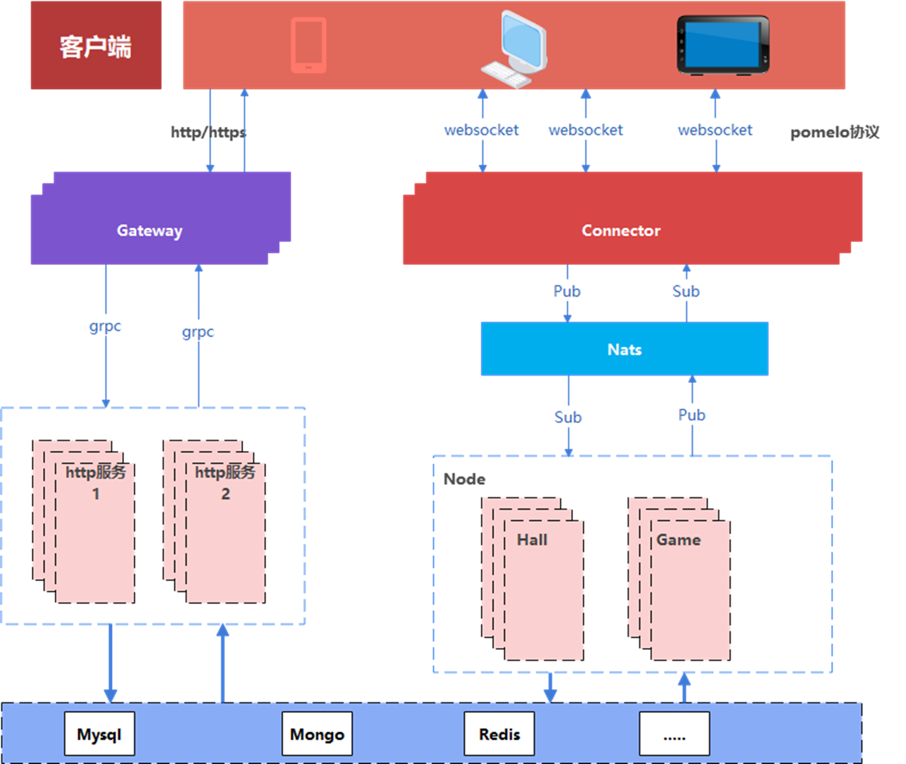
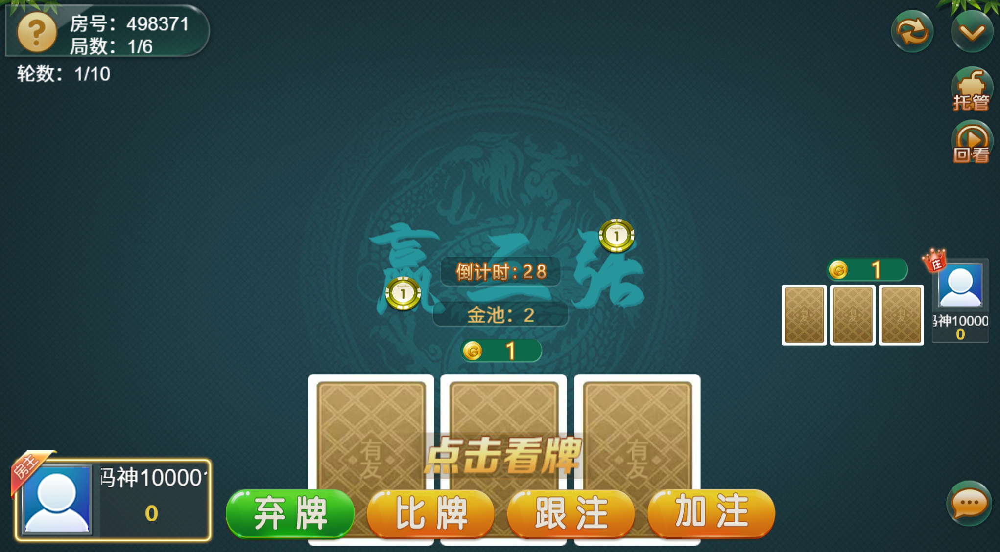
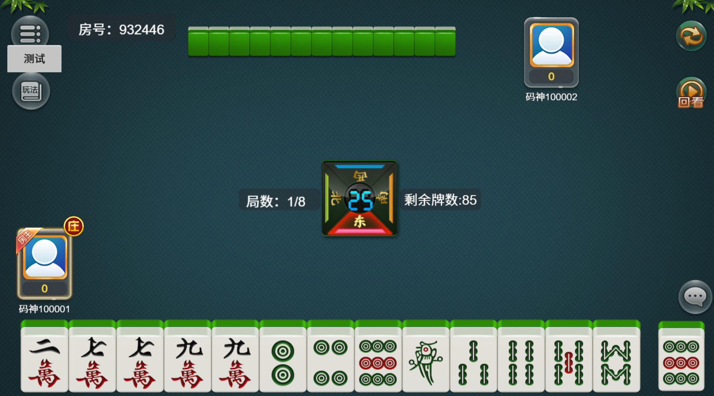
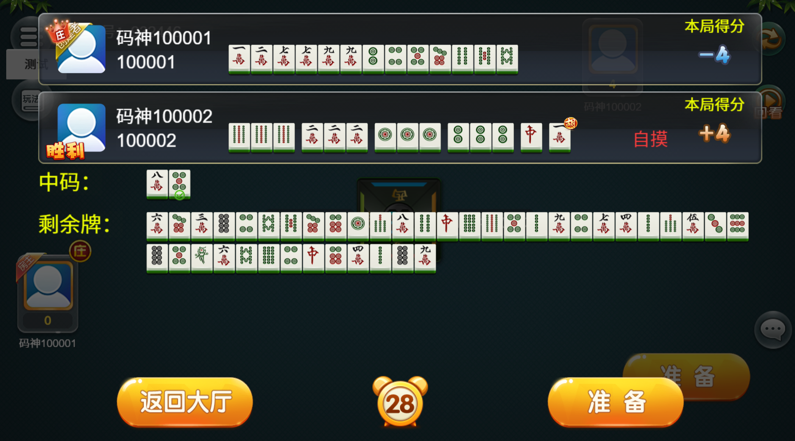

## 代码说明

> 该代码为`https://www.mszlu.com/docs/qp/01.html`棋牌项目的后端源码，教程购买可访问: `https://www.mszlu.com/course/detail/3`进行购买

* 购买项目可以加我V ：`mszlu521`
* 也可以通过`抖音`和`B站`搜索`码神之路`进入店铺或者课程专栏进行购买
* 本项目源码会持续更新，会对课程中的代码进行持续改进和完善
* 购买课程的`用户`可以克隆本项目做为参考

## 客户端与版本说明

本仓库只发布棋牌游戏后端代码，不包含客户端工程、客户端资源或客户端构建产物。

当前配套客户端基于 **Cocos Creator 3.8.8** 迁移开发，客户端工程不上传 GitHub。需要完整客户端、资源、界面和可运行构建包，请联系作者单独购买。

后端当前配套支持的主要玩法包括：

* 拼三张
* 牛牛
* 跑得快
* 三公
* 扎鸟麻将/红中麻将相关玩法
* 斗公牛

客户端版本和配套内容会持续维护更新；GitHub 中的本仓库用于展示后端架构、服务端实现和联调基础，不代表客户端源码的授权范围。

## 房费结算

普通房间的 AA 支付和我支付在开局时收取一场房费，同一场后续小局不重复扣费；赢家支付在整场结束或至少完成一小局后解散时结算，尚未完成任何小局时解散不收取赢家房费。

赢家支付由实际参赛玩家中总分最高者承担一份房费。多人并列最高（包括全员平局）时共同均摊这一份费用；钻石不足以整除时，按用户 UID 升序给前面的玩家各分配 1 颗余数。例如房费 5 颗、两人并列时分别扣 3 颗和 2 颗，总计仍为 5 颗。旁观者不参与分摊，重复结算不重复扣款。

亲友圈房间由圈主按游戏和局数对应的单人费用、实际参赛人数支付，独立于普通房间的支付选项。

## 项目架构

## 项目特色

* 从零开发游戏框架
* 基于框架完成拼三张和红中麻将
* 分布式游戏框架，支持集群部署
* 可商用运行
* 提供前后端源码笔记视频和微信群答疑

## 面试介绍

项目描述：

基于房卡模式的棋牌游戏平台，涵盖了拼三张，红中麻将等多种游戏类型，从零开始设计并实现了完整的游戏后端框架，具备高可用行和高可扩展性，能够快速匹配同类型游戏的规则和玩法。

所用技术：

golang，自研游戏框架，mongo，redis，websocket，docker，k8s等

技术亮点：

* 从零开发了一套轻量级、高性能的游戏框架，模块化设计，支持快速接入新游戏
* 采用了websocket实时通信，pomelo通信协议，可集群化部署，实现了高并发通信
* 支持创建私人房间、好友邀请及亲友圈功能，提升了玩家的社交互动体验
* 完整实现了拼三张，麻将等的玩法，比如胡牌算法等
* MongoDB 和 Redis 实现游戏数据的高效存储与读取
* 服务拆分为网关、游戏逻辑、大厅管理，用户管理等多个微服务模块，提升了系统的灵活性与可维护性

项目成就：

* 系统稳定运行，支持数万在线用户
* 平均延迟控制在 50ms 以下，用户体验良好
* 模块化框架成功应用于多个类似项目，显著缩短了开发周期

## 声明

* 本源码只有购买了课程的用户具有完全的商业授权（可出售）
* 未购买课程的用户可以对源码进行学习和使用，禁止商用
* 客户端工程不在本仓库发布；如需 Cocos Creator 3.8.8 客户端及配套资源，请联系 `mszlu521` 咨询购买
